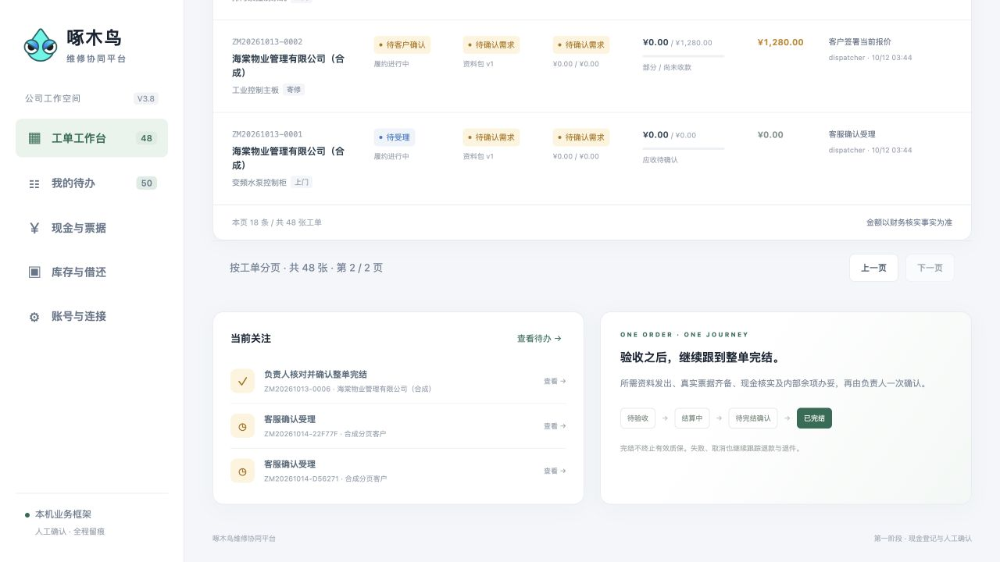
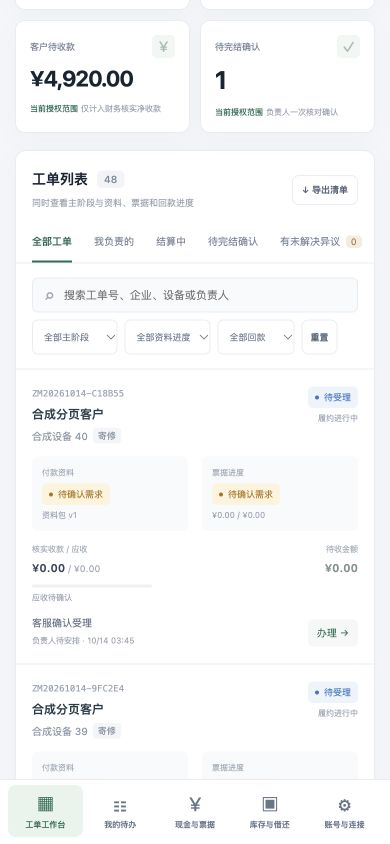

# V3.8 回归问题修复说明 · 2026-10-14


[toc]

---

## 🔥 <font id=前言>前言</font>

本页保留首次修复的验证结果。随后 [二次回归](./二次回归报告-2026-10-14.md) 未全部通过，并新增发现交叉场景问题；当前最新状态请以该报告为准。

回归报告中的 R01—R08 已按桌面 V3.8 工作台范围修复并完成统一回归。最终后端检查为 **68 个根测试、134 条测试通过结果，0 失败、0 跳过**；网页 **48 项通过**，HTTP **6 组通过**。这些结果说明本机合成框架的已测合同有效，不能替代生产身份、完整灾备或全部 PRD 验收。

改动限于桌面项目自有工作台源码、测试和文档；原需求报告、原仓源码与现有运行数据保留，未提交或推送。架构入口见 [代码地图](../代码地图.md)，接口细节见 [工作台约定](./workbench-contract.md)，运行方法见 [部署文档](../部署文档.md)。

[修复清单](#fixes) · [授权与恢复](#authorization-recovery) · [统一回归](#regression-results) · [浏览器证据](#browser-evidence) · [复跑方式](#reproduce) · [剩余边界](#remaining-limits)

## 一、<span id="fixes">R01—R08 修复清单</span> <a href="#前言" style="font-size:17px; color:green;"><b>🔼</b></a> <a href="#🔚" style="font-size:17px; color:green;"><b>🔽</b></a>

| 编号 | 问题 | 修复后的行为 |
| --- | --- | --- |
| R01 | 旧备份恢复复活工单权限 | 合并当前账号与工单四个授权字段、证据删除约束和稳定 ID 审计；缺当前约束即拒绝，不恢复旧联系人／执行人权限 |
| R02 | 内部成本、提成读取过宽 | 服务端按职责统一过滤详情、摘要、导出、写响应、幂等重试、事件及原件；工程师／仓库保留本人成本，QC 无成本提成 |
| R03 | 导出缺少持久审计 | 完整详情、原件下载、导出先持久保存审计再返回资料，保存失败拒绝；管理员可从设置页或 `GET /api/v38/audit` 分页查看 |
| R04 | 账号授权变更原因丢失 | 原因、操作人、前后状态与授权版本同账号变更原子保存，失败不留下已变更账号或孤立成功记录 |
| R05 | 错误的 2xx 被当成成功 | 校验响应结构、字段类型及关联资源；写入超时或结构错误标为结果未知，保留输入与原请求意图，不显示保存成功、不自动重放 |
| R06 | 跨源配置与文件预览不一致 | API 地址只允许当前网页同源；跨端口先打开目标服务网页；`file://` 只供离线合成预览，不发 API 请求、不回退旧端口 |
| R07 | 10,000 条幂等归档硬停 | 保留所有已处理键与内容摘要，历史工单／借用／采购响应压缩为稳定资源 ID 并兼容旧响应；8,000 预警、10,000 参考阈值，超过仍可写 |
| R08 | 首屏读取全量工单与事件 | bootstrap 默认 30 条轻量工单及 `orderPage/metrics/capacity`；列表由服务器搜索、筛选和分页，完整详情按需读取，全范围概览保持完整口径 |

摘要标记 `isSummary=true`，不含完整事件、证据、报价历史、签名、成本或提成；摘要不能当作完整详情使用。明确成功后的另一笔同内容采购、借用或办理会生成新请求键，同一次结果未知的办理保留原键核对，防止重复业务与合法重复被吞掉。

## 二、<span id="authorization-recovery">授权、审计与恢复边界</span> <a href="#前言" style="font-size:17px; color:green;"><b>🔼</b></a> <a href="#🔚" style="font-size:17px; color:green;"><b>🔽</b></a>

| 角色 | 成本与提成 | 必要资料 |
| --- | --- | --- |
| 管理员／调度／财务 | 可读全部授权工单财务 | 内部资料及审计按接口角色授权；安全审计页仅管理员 |
| 工程师／仓库 | 仅 `OwnerID` 为本人的成本；无提成 | 本人登记现金、已核实对客收款、本人余项及职责资料 |
| QC／外部角色 | 无成本、提成 | 已核实对客收款、授权公开资料；外部沿用企业与当前参与人隔离 |

工程师仍须是当前执行人，客户同时符合当前联系人与企业。财务审核、发票、现金交接事件的内部正文脱敏；公开维修报告及本人上传资料可读，已删证据不可读。附件当前按阶段、资料引用和上传人隔离，具体矩阵见 [读取权限](./workbench-contract.md#field-permissions)；阶段不能替代正式用途分类。

隔离恢复要求新目标、原密钥、备份及清单、最新源。按稳定工单 ID 合并 `customerId/companyId/assigneeId/ownerId`，按工单与证据 ID 合并当前删除约束；当前约束缺失或损坏则拒绝。审计按稳定 ID 合并并新增恢复事件，旧会话不复用。**报价、签署、现金及库存等业务事实仍回到备份点**，当前授权合并不等于恢复全部最新业务。

HTTP 登录成功／失败、鉴权拒绝、退出与账号变更留有应用审计；完整详情、原件下载、导出先保存读取审计，失败不释放资料。列表／bootstrap 在业务锁内重查授权，不批量生成每条摘要读取日志。应用审计保存在加密快照中，尚无独立不可篡改运维审计副本。

## 三、<span id="regression-results">统一回归结果与首次失败记录</span> <a href="#前言" style="font-size:17px; color:green;"><b>🔼</b></a> <a href="#🔚" style="font-size:17px; color:green;"><b>🔽</b></a>

证据集中在 [验证目录](./修复验证-2026-10-14)，汇总见 [test-summary.json](./修复验证-2026-10-14/test-summary.json)。2026-10-13 历史基线继续保留在 [实现范围](./实现范围.md#verified)。

| 检查 | 最终结果 | 证据 |
| --- | --- | --- |
| [**Go**](https://go.dev/) 全工程竞态回归 | `-race -p 1 ./...`；68 个根测试，134 条测试通过结果，0 失败、0 跳过；134 包括子测试，不是 134 个独立根测试 | [go-tests.jsonl](./修复验证-2026-10-14/go-tests.jsonl) |
| Go 静态检查 | `vet` 退出 0，无诊断输出 | [go-vet.log](./修复验证-2026-10-14/go-vet.log) |
| 网页测试 | 48 项通过：旧 Web／WebAdmin 26＋Workspace 22（8 数据规则＋14 应用交互） | [web-tests.log](./修复验证-2026-10-14/web-tests.log) |
| HTTP 样例业务 | 6 组通过，登录／授权、报价签署、现金核实交接、版本幂等、借还与完结门槛继续通过 | [http-smoke.log](./修复验证-2026-10-14/http-smoke.log) |
| 构建 | MacOS ARM64 本机构建、Linux AMD64／Windows AMD64 交叉构建通过；后两者未实机运行 | [native-build.log](./修复验证-2026-10-14/native-build.log)、[cross-builds.json](./修复验证-2026-10-14/cross-builds.json) |
| 1,000 工单响应观察 | 合成 bootstrap 为 64,866 字节，首页 30 条，全局工单数 1,000；属于单次响应量观察，不是吞吐／并发指标 | [test-summary.json](./修复验证-2026-10-14/test-summary.json) |
| 代码地图与符号索引 | 模块、接口、关键函数和测试导航已加入；CodeGraph 完整索引 109 文件、1,967 节点、7,103 条边，已实查调用与测试关系；排除路径无违规项 | [代码地图](../代码地图.md)、[索引检查](./修复验证-2026-10-14/codegraph-check.json) |
| 范围与清理 | 自有临时服务、测试数据库、测试存储／密钥／二进制已清理，浏览器标签关闭、视口复位；原数据归档未修改 | [source-scope.json](./修复验证-2026-10-14/source-scope.json)、[cleanup.json](./修复验证-2026-10-14/cleanup.json) |

**首次平行全套执行曾失败**：旧基线 `TestRepositoryContract/tidb-optimistic` 出现操作结果不确定错误，根测试随之失败，完整记录保留在 [go-parallel-first.jsonl](./修复验证-2026-10-14/go-parallel-first.jsonl)。该合同独立重跑通过，见 [tidb-contract-retry.jsonl](./修复验证-2026-10-14/tidb-contract-retry.jsonl)，随后最终 `-p 1` 完整竞态回归通过。没有丢弃失败记录，也未将重跑通过解释成已证明所有并行负载稳定。

## 四、<span id="browser-evidence">浏览器分页、详情与审计证据</span> <a href="#前言" style="font-size:17px; color:green;"><b>🔼</b></a> <a href="#🔚" style="font-size:17px; color:green;"><b>🔽</b></a>

真实浏览器以 1280×720 和 390×844 视口核对 48 条合成工单：第一页 30、第二页 18，全范围概览 48；打开完整详情后再办理。桌面与手机尺寸截图有效，但手机尺寸视口不是实体手机验收。

| 观察 | 证据 |
| --- | --- |
| 工单页数、当前页条数与概览一致 | [第一页 AX](./修复验证-2026-10-14/browser-page1.ax.txt)、[第二页 AX](./修复验证-2026-10-14/browser-page2.ax.txt)、[分页截图](./修复验证-2026-10-14/browser-pagination.png) |
| 办理前读取完整详情 | [详情 AX](./修复验证-2026-10-14/browser-detail.ax.txt) |
| 手机尺寸页面 | [手机 AX](./修复验证-2026-10-14/browser-mobile.ax.txt)、[手机尺寸截图](./修复验证-2026-10-14/browser-mobile.png) |
| 安全审计显示 4 条记录 | [审计 AX](./修复验证-2026-10-14/browser-audit.ax.txt)；该证据为可访问性文本，不是审计截图 |
| 跨源 API 地址被拒绝 | [连接拒绝 AX](./修复验证-2026-10-14/browser-cross-origin-rejected.ax.txt) |

[browser-accounts.png](./修复验证-2026-10-14/browser-accounts.png) 仅是账号页面截图，不用作安全审计截图证明。浏览器样例配置见 [browser-fixture.json](./修复验证-2026-10-14/browser-fixture.json)，临时运行信息见 [browser-runtime.json](./修复验证-2026-10-14/browser-runtime.json)。





## 五、<span id="reproduce">复跑入口</span> <a href="#前言" style="font-size:17px; color:green;"><b>🔼</b></a> <a href="#🔚" style="font-size:17px; color:green;"><b>🔽</b></a>

在项目根执行。全工程数据库集成需已有专用回环测试实例，并设置 `REPAIR_TEST_TIDB_DSN` 与 `WB_TEST_TIDB_DSN`；前者数据库名要求 `repair_test_` 前缀，测试会创建并清理自己的隔离库。未设置会跳过数据库测试，不能复现本报告的 0 跳过结果；不要指向现有业务数据库，也不要把 DSN 凭据写进日志或报告。

```sh
./Tools/go/bin/go -C Server test -race -p 1 ./... -count=1
./Tools/go/bin/go -C Server vet ./...
node --test WebAdmin/tests/*.test.cjs Web/tests/*.test.cjs Workspace/tests/*.test.cjs
node Scripts/验证工作台.mjs
```

便携 Go 仅匹配 MacOS ARM64；其他平台使用匹配工具。HTTP 脚本启动并清理自己的临时服务与样例数据。备份／恢复另按 [隔离恢复](../部署文档.md#isolated-restore) 办理，不覆盖现有数据目录。

## 六、<span id="remaining-limits">仍需后续实施与验收</span> <a href="#前言" style="font-size:17px; color:green;"><b>🔼</b></a> <a href="#🔚" style="font-size:17px; color:green;"><b>🔽</b></a>

- 业务、媒体、请求记录与应用审计仍保存在单个加密聚合快照；工单分页和历史响应压缩降低读取量与重复响应，不等于已经实现关系表、独立媒体或无限增长。库存、借还、采购列表仍随首屏返回。
- 附件阶段与上传人是当前可用的隔离依据，不能替代正式用途／密级分类与明确授权；自由文本及资料使用范围仍需生产业务复核。
- 审计是应用内持久记录，未交付独立不可篡改运维审计副本、独立告警和完整生产身份方案。
- 当前恢复仍要求最新源；整机／主场所损失、独立介质／异地备份、完整 TiDB 灾备与 RPO／RTO 尚未完整验收。
- 可信 HTTPS、真实账号及企业授权、数据库证书和部署拓扑、容量／并发、全部 PRD 与实体手机场景仍需正式验证。多设备分批、结构化销售逐项出库、真实付费渠道、AI 与独立 IM 保持既有阶段边界。

完整范围见 [实现范围](./实现范围.md#before-real-testing)。当前结果可支持继续合成演示与后续开发，不宣称生产上线或全部安全验收已完成。

<a id="🔚" href="#前言" style="font-size:17px; color:green; font-weight:bold;">我是有底线的➤点我回到首页</a>
