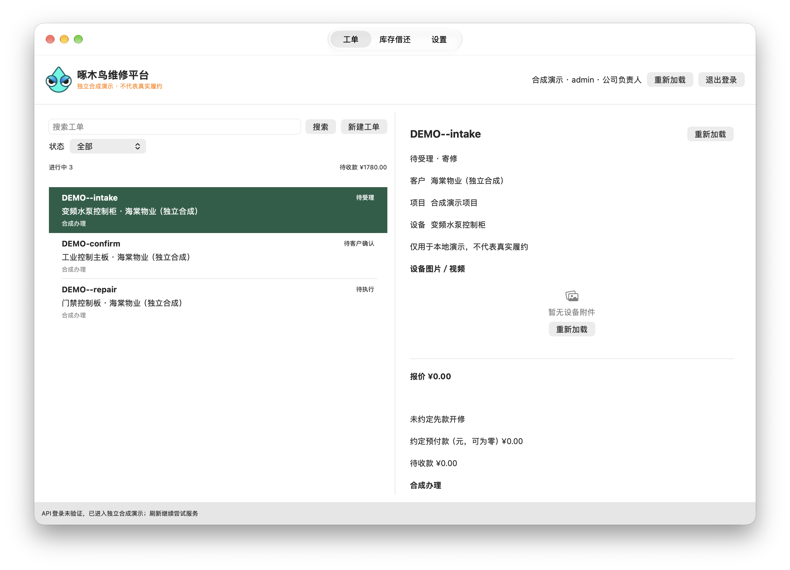
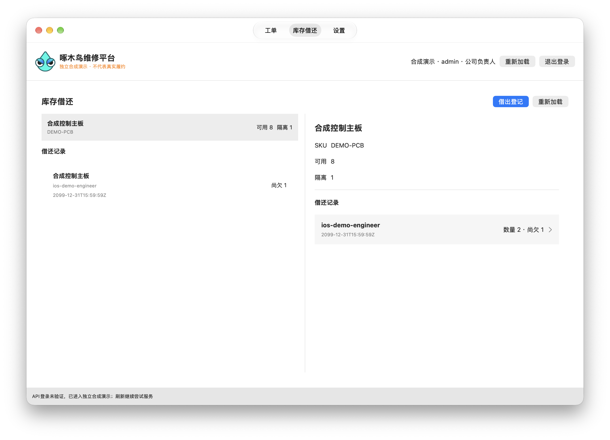
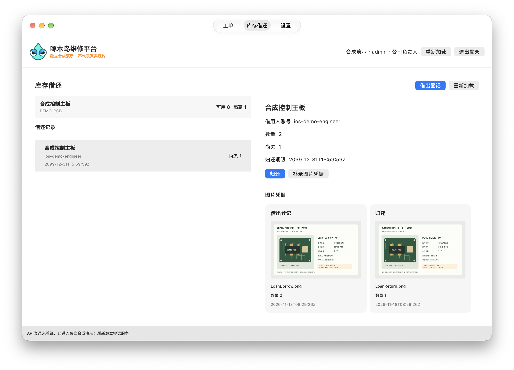
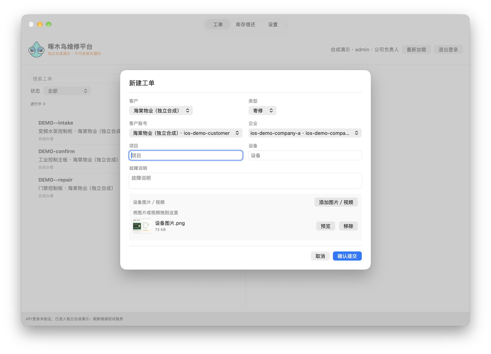
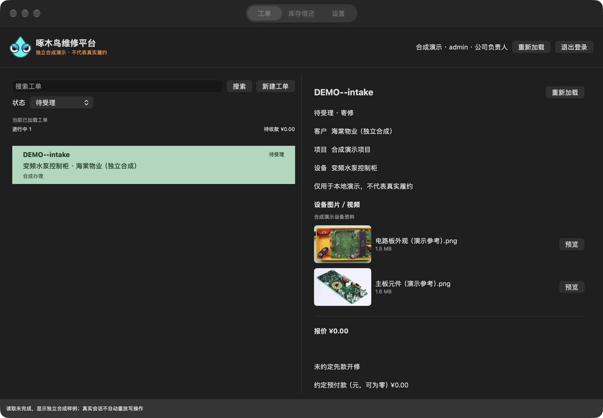
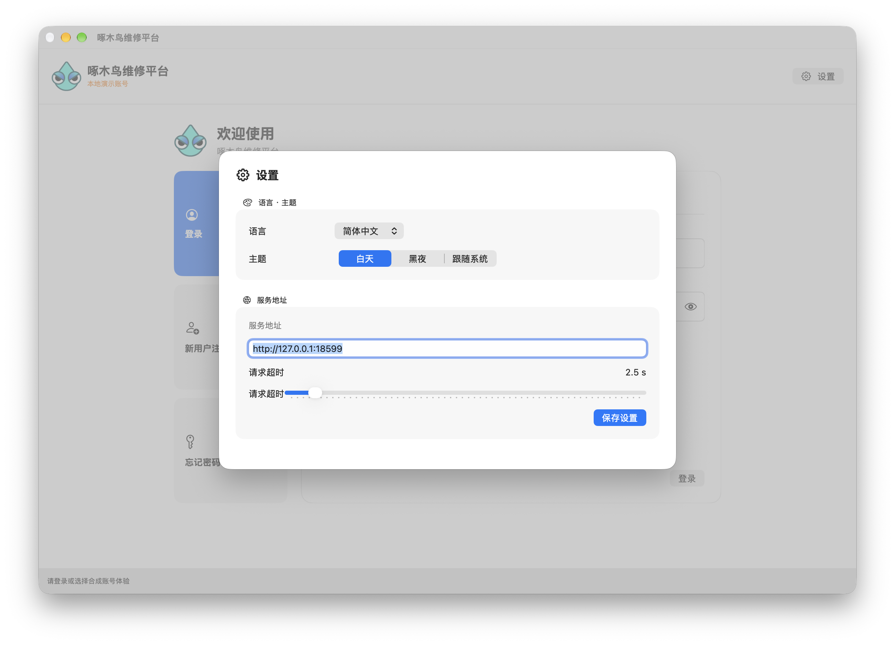

# 啄木鸟维修平台 · PC 原生桌面资产盘点

<!-- jobs-toc:start -->
<!-- jobs-toc:source {"v":2,"token":"[toc]"} -->

📚 目录（点击展开 / 收起）

- [🔥 前言](#%E5%89%8D%E8%A8%80)
- [一、资产、默认值与生命周期](#inventory)
- [二、当前实测与交付边界](#verification)

<!-- jobs-toc:end -->

---

## 🔥 前言

用户要求PC端同时交付MacOS与WindowsOS原生程序。当前按平台分别实现原生UI，复用现有API合同，不使用网页套壳或跨平台GUI。此表只登记现行资产与验证，不将交叉编译或源码具备外推为目标系统实机验收。

## 一、资产、默认值与生命周期 <a href="#前言" style="font-size:17px; color:green;"><b>🔼</b></a> <a href="#🔚" style="font-size:17px; color:green;"><b>🔽</b></a>

| 资产／入口 | 实现、默认值与持久化 | 生命周期与代码位置 | 当前验证 |
| --- | --- | --- | --- |
| [Mac原生工程](../代码/前端/PC端/MacOS/README.md) | SwiftUI原生窗口；完整源码与构建入口；最低MacOS13；App资源自含，通用架构 | `RepairDesktopApp`、`DesktopView`；关闭客户端不停止后端 | Apple Silicon本机构建、签名核验与实际启动；Intel交叉编译 |
| [Windows原生工程](../代码/前端/PC端/WindowsOS/README.md) | C#／WPF；自包含win-x64 EXE+Resources；无需Python | `Program`、`MainWindow`；双击成品，设置存当前用户应用数据 | 实际交叉发布成功，PE32+GUI x64核验；Windows图形运行未验 |
| API连接与会话 | 默认回环8098、2.5秒超时，可改0.5～30秒；认证令牌／密码仅内存 | Mac重用WBStore、独立URLSession适配；Windows `WorkbenchClient`；禁止跟随HTTP重定向 | 两客户端向隔离真实Go后端18201完成登录、读写与401隔离 |
| 正常认证／本地演示 | 登录／注册／邮箱找回独立卡片；三入口图上字下居中，验证码按钮42px与输入框等高、纸飞机及发送状态；本地演示角色预填明文、眼睛切换，远程／正式关闭演示 | 密码／令牌／临时注册客户只内存；验证码10分钟、60秒／5次；会话撤销、身份／来源变更阻止迟到结果 | 真HTTP注册／找回／邮箱登录及离线本地客户隔离、真实401拒绝通过 |
| 工单 | 搜索、30条分页、完整详情、43项动作字段、版本及请求键；显示列表从1连续编号与创建时间，详情含更新日期；点击行持续背景／前景区分，Logo可见、姓名与角色相同去重 | Mac详情选择序号；Windows读取版本与忙态；开页身份／来源核验 | 真实HTTP新建与备注版本推进；Mac已实际点击选中，Windows协议通过、图形另验 |
| 工单状态与搜索 | 两原生端联合过滤，刷新／加载更多保留条件；真实API仍请求状态与搜索，本地演示采用相同业务字段和角色范围；汇总标为当前已加载工单 | Mac `DesktopModel.visibleOrders`／`DesktopView`；Windows `WorkbenchClient`／`MainWindow`；被过滤选择清空详情，读取序号拒绝迟到结果；不新增磁盘持久状态 | Mac实际待受理仅一单；模型回归覆盖离线3→1、联合条件、空结果、角色字段、受控API及30＋1分页。Windows合同覆盖本地32／API夹具65条与迟到分页，原生UI另验 |
| 三张预埋设备资料 | 待受理两图、待客户确认及待执行各一图一视频；详情显示图片缩略图和视频封面／播放入口，明确演示参考 | 共享 `media-seed.json`＋3张PNG／1段MP4；Mac `WBDemoMediaSeed`／`DesktopDeviceMedia`，Windows `WorkbenchClient`／`NativeMediaPreview`。仅固定合成种子挂载，身份隔离、大小／SHA校验，退出清临时副本；真实／新建工单不继承 | 六项元数据及原件SHA匹配；Mac图片解码与13.8秒视频轨道可播放检查通过，实际窗口显示待受理两图。系统播放器点验因界面工具超时未完成；Windows图形解码／播放待实机验 |
| 客户目录与新建设备媒体 | 客户／账号／企业联动下拉，各自授权新建，支持一客多账号／企业；设备图视频文件流上传、uploadId随单原子关联，不设应用大小／数量上限，选择与拖入同一路径 | 真实目录与元数据服务持久化，原件分块加密磁盘旁件与备份一起保管；本地演示独立内存／受控临时原件；新建弹卡随内容布局，旧身份关闭 | 真实HTTP新客户→第二企业／账号→PNG＋MP4建单、48MiB视频／十附件与回执拒绝负例通过；Mac／Windows原生流式客户端专项均通过 |
| 客户档案与三联动 | 老客户下拉自动带真实账户／企业；管理员／调度可各自新建客户、账户、企业；客户分组支持多账户／企业，既有Actor单企业授权不放宽 | Mac `DesktopCustomerDirectory`／`DesktopDirectoryEditor`／`DesktopCreateForm`；服务 `customer_directory.go` 与 `State.customers`；密码仅用于盐摘要，不返回 | 真实持久凭据、同键不重复、客户本人投影、跨企业拒绝、重启与失败回滚专项通过；Mac实际弹卡带出老客户账户／企业，完整新建菜单交互仍按各端范围验收 |
| 初始设备图／视频 | 原件可选择或拖入、显示缩略图／预览／移除；PNG/JPEG/GIF/WebP及MP4/MOV/WebM不设应用大小／数量上限 | 磁盘文件流上传、校验SHA后凭uploadId与工单原子关联；私有流式下载；失败保留草稿，不留空单；切身份／地址／来源关闭旧表单 | 后端流式HTTP11组与Mac／Windows真实客户端专项通过，含超过旧限额、十附件、跨户拒绝、原子关联、重试及重启；Mac实际从Finder拖图后出现缩略图和操作入口，按钮选择受本机系统文件面板服务中断影响未完成点验 |
| 签署／日期 | 冻结报价／先款／预付／自动验收条款，手写PNG、报价版本只读、显式确认；截止日上海23:59:59 | 原生Canvas／InkCanvas；非本人／错版本由后端拒绝，演示不模拟签署成功 | 源码与构建通过；实际手写、完整签署链、Windows日期交互待验 |
| 库存借还 | 配件可选详情、关联借还；借还行灰色选中，列表／关联记录连续编号、显示可读借出与到期时间，借出／部分完好或隔离归还附图、补录与原件预览 | Mac `DesktopInventoryView`／`DesktopLoanProofForm`；Windows原生借还与预览；服务端原子校验数量、版本和图片；借还图片仍为单图8MiB、8张／32MiB | 两客户端真实借出／部分归还／原件下载通过；Mac实际点击配件→SKU与数量→关联借还→灰色选中及两张合成凭据；Windows图形另验 |
| 设置与认证布局 | 外观／连接靠上，语言主题左对齐；弹卡保存成功关闭、错误保留；认证右卡与左三卡总高度一致、无重复标题、输入框加高；三入口图标在上、文字在下、组合水平／垂直居中；Mac40pt图标／24pt标题，Windows42×42矢量图／26逻辑像素标题，长译文居中换行 | 语言／主题当前用户持久化；连接只在保存校验后提交；减少动态效果取消滑动；大小只影响布局，不新增持久状态；Mac `DesktopAuthView.swift`、Windows `NativeAuthenticationView.cs` | Mac通用架构与严格签名通过，当前源码／资源清单一致，白天／黑夜三门切换实际查看；Windows重发布与当前源码／资源清单核对通过，Windows界面未实机验 |
| 密码字符策略 | 键入／粘贴、明文／密文及提交禁止emoji，确认密码与目录创建密码同规则；保留普通中外文字、数字与ASCII标点 | Mac `DesktopPasswordPolicy`／`DesktopPasswordField`，Windows `PasswordCharacterPolicy`／`NativePasswordField`，后端 `password_policy.go`；共用Unicode18范围并随包分发许可；拒绝后须合法编辑再提交 | Mac1508项算法／时间检查、Windows1582项协议前置检查、后端全套race+vet与最后5组定向密码回归通过；原生输入法／系统粘贴的完整交互仍按设备验收 |
| 时间与列表序号 | 按当前显示／筛选列表从1编号，追加页连续；工单创建／更新、借出／归还期限及凭据时间按上海时区显示日期与时分 | `DesktopTimestamp`、`WBLoan.createdAt`／`WBContract.loan`及后端 `Loan.CreatedAt`；新借出取真实事件时钟，旧缺失显示“时间未记录”，不回填现在时间；编号不入业务主键 | 纳秒ISO解析、时区与缺失值检查通过；后端固定时钟、新建重试／归还／重启及旧值兼容通过；全部列表的目标系统图形点验另验 |
| 语言／主题 | 十语言完整静态文案；白天／黑夜／跟随系统，默认简中＋系统 | Mac UserDefaults；Windows当前用户preferences；语言环境同步原生日期控件 | 十语键覆盖核验与构建通过；全部语言字体、布局及系统主题设备验收待验 |
| 服务端优先／演示回退 | 进入、刷新和写操作正常请求；仅本地演示门禁允许独立合成回退，恢复后真响应覆盖；不补传 | Mac重用既有业务合同；Windows认证锚点独立于demo actor；401撤销，403／409／422拒绝，未知写保留请求键 | Mac断网独立样例通过；Windows503回退→恢复、未知写同键、403拒绝、401撤销通过 |
| 本地素材 | 复用RepairLogo，借还凭据为Jobs原创可编辑SVG＋打包PNG；设备示例为Wikimedia可追溯实物资料，明确演示参考 | 资源与App／EXE可核对；设备资料作者、原址、转换及CC BY-SA许可在共享契约README及随包credits；正常凭据使用实际选择的原件 | 本地Logo实际显示；借还原件HTTP与图片解码通过 |

## 二、当前实测与交付边界 <a href="#前言" style="font-size:17px; color:green;"><b>🔼</b></a> <a href="#🔚" style="font-size:17px; color:green;"><b>🔽</b></a>

- Mac在本机实际启动，角色预填登录后进入独立合成工单；点击行后有持续背景区分。密码可明密切换。设置有效保存后弹卡消失，非法地址显示错误且保留弹卡；验收保存使用原有地址与超时，未改用户连接配置。限定流程实测不代表全部业务、语言或完整手写签署验收。
- Mac实际点配件可见SKU、可用／隔离与关联借还，再点关联行显示借还详情和两张合成凭据，选中行有灰色背景。Finder原生拖入图片成功显示缩略图、预览／移除入口；未把这次草稿写入真实业务。按钮文件选择实际触发系统NSOpenPanel，但本机OpenSavePanels服务返回XPC连接中断，未完成选择点验，未重启或修改系统服务。
- 设备媒体[流式HTTP专项](../测试/后端/接口/验证设备流式附件.mjs/README.md)11组通过：真实短片加48MiB合法容器padding、十附件、同键重试、跨账号与原子拒绝、私有下载SHA及重启。Mac客户端另实跑9件35+MiB，Windows实跑约48MiB及9件；应用无人工大小上限仍需目标环境有可用磁盘／网络，非公网吞吐或无限物理容量证明。
- [真实客户端合同测试](../测试/前端/PC端/原生桌面端/README.md)使用当前Go源码的独立临时运行目录，创建合成资料；未读写用户原业务目录。Swift原生传输与Windows客户端均实际发HTTP，不是静态源码检查。
- Windows的协议测试运行于Mac无GUI宿主；WPF已经实际发布成可执行文件，Windows实机运行／输入／主题／字体、安装及SmartScreen仍待验。
- 预埋设备资料与工单过滤已进入两端成品。Mac当前51项源码／14项资源、Windows16项源码／工程记录及14项资源摘要匹配；筛选API验证使用受控传输，不冒充真实HTTP端到端验收。Mac隔离预览实际观察待受理一单及两张设备图片；系统播放器交互未验。
- 四个桌面成品的源码及资源SHA256清单全部匹配；Mac签名核验、维修arm64／x86_64通用二进制与两份Windows PE32+ GUI x64均通过。媒体备份配套的Windows存储等待夹具23项通过，实际假CLI覆盖61秒备份／恢复、60秒清零超时及取消回收，未执行真实反部署。
- 认证卡片采用图上字下居中与等高验证码按钮，Mac隔离预览已查看基本布局；三门及各语言的完整键盘／输入法操作仍按设备验收。当前居中布局见[原生窗口截图](./Assets/MacOS认证居中.png)。预览从当前Dist复制、只替换Bundle身份与签名以隔离偏好；主窗口的新建工单草稿不作为测试资料。小窗口边缘拖动未实际改变尺寸，全部长语言渲染和Windows原生图形仍待设备验证。密码策略通过当前算法／API专项；页面预览不替代真实输入法或Windows图形验收。
- 当前原生端覆盖工单主线、动作表单、客户联动目录、初始设备图／视频与库存借还；普通证据专项、个人日志、审计导出、采购专项界面仍由现有Web提供。独立样例只演示支持的动作，复杂票款与客户签署明确要求连接服务，不伪造成功。
- Mac使用ad-hoc签名，Windows未Authenticode签名；公证、正式发布、跨机隔离启动、真实公网以及最低资源性能仍未验。成品与源码均保留，未提交、推送或修改远程仓库。

<a id="🔚" href="#前言" style="font-size:17px; color:green; font-weight:bold;">我是有底线的➤点我回到首页</a>
