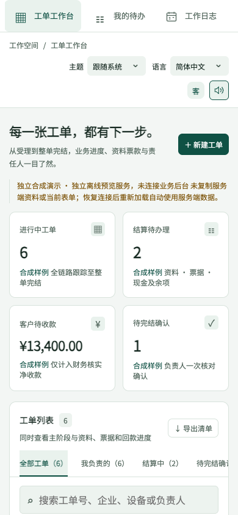
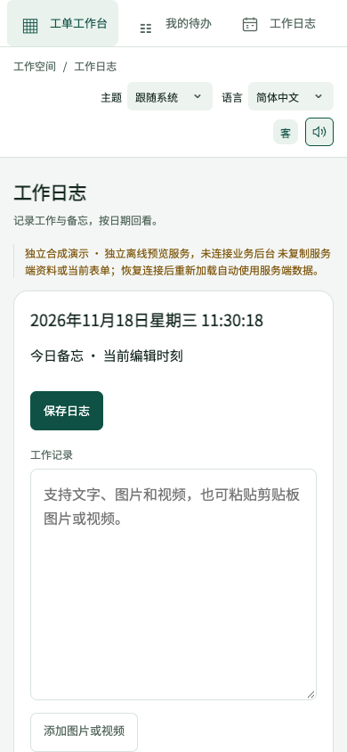
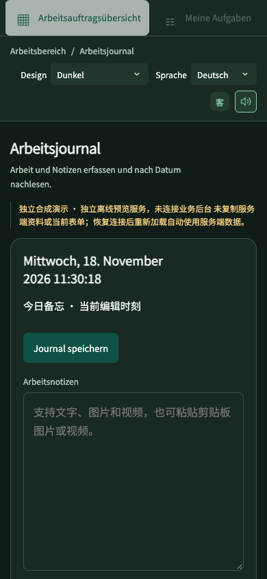

# 啄木鸟维修平台 · 客户端资产盘点

<!-- jobs-toc:start -->
<!-- jobs-toc:source {"v":2,"token":"[toc]"} -->

📚 目录（点击展开 / 收起）

- [🔥 前言](#%E5%89%8D%E8%A8%80)
- [一、工程文档与产品名称](#documents)
- [二、Web 手机竖屏](#web-portrait)
- [三、原生桌面](#native-desktop)

<!-- jobs-toc:end -->

---

## 🔥 前言

本页集中维护本项目文档入口、PC 原生桌面与 Web 手机竖屏的当前实现及验证边界。源码具备、构建成功、目标系统运行和生产验收分别登记。

## 一、工程文档与产品名称 <a href="#前言" style="font-size:17px; color:green;"><b>🔼</b></a> <a href="#🔚" style="font-size:17px; color:green;"><b>🔽</b></a>

| 资产 | 当前入口／行为 | 核对结果 |
| --- | --- | --- |
| iOS 工程说明 | [iOS README](../代码/前端/移动端/iOS/README.md) 集中运行、工程职责、私库版本、代码地图与外置测试 | 三份子目录文档合并，旧目录移除；160 个本地文件及锚点引用、标题唯一性、目录转换往返已核对 |
| 单元定位 | [开发单元导航](../代码/README.md#unit-code-maps) 进入各工程；iOS 直接进入合并文档的代码地图章节 | 工程、测试与交付引用同步 |
| 产品显示名 | 工作台页面标题与本地品牌为“啄木鸟维修平台”；管理端保留职责说明 | 本次涉及的 Web 与桌面按此名称组织；其它平台当前配置沿用各端说明，不外推本次重新构建 |

## 二、Web 手机竖屏 <a href="#前言" style="font-size:17px; color:green;"><b>🔼</b></a> <a href="#🔚" style="font-size:17px; color:green;"><b>🔽</b></a>

| 资产 | 入口、默认值与生命周期 | 代码位置／验证 |
| --- | --- | --- |
| 手机导航 | 600px 及以下改顶部可横向滑动导航，六个入口完整保留；桌面仍用侧栏 | [样式](../代码/前端/PC端/Web/维修工作台/styles.css)，手机页不再压缩成六个底部窄按钮 |
| 工单与表单 | 手机工单为双列字段卡片，详情全屏、表单单列；输入字号16px，关闭控件44px；安全区随设备计算 | [页面](../代码/前端/PC端/Web/维修工作台/index.html) 开启 `viewport-fit=cover`；详情标题与标签自然滚动，避免长翻译标题覆盖标签 |
| 日志与提醒 | 窄屏编辑器和日历单列；提醒在安全区上方显示；内存草稿随账户生命周期清理 | 现有 `personal.js` 行为保留；本次只调整布局 |
| 语言与主题 | 十语言；默认跟随系统，支持白天／黑夜；既有本地偏好键保留 | 不改变业务值或真实数据保存范围 |
| 数据来源 | 页面及重载照常请求 API，失败显示独立合成样例，成功后采用服务端响应 | 本机离线预览只提供静态页面，不读取业务数据；空态保留重新加载 |

已用本机 [**Chromium**](https://www.chromium.org/) 完成80组验证：320／390／430／768／1440宽度的六个业务页，以及320px下十语言、三主题、新建及详情弹窗；均无整页横向溢出。合成触控将顶部导航实际滑动341px；空态重载与本地新建可操作，页面无未捕获异常。既有 Web 测试191项通过，样式检测无发现。浏览器模拟不等于真实手机、Safari软键盘、触控签名或公网业务验收。

## 三、原生桌面 <a href="#前言" style="font-size:17px; color:green;"><b>🔼</b></a> <a href="#🔚" style="font-size:17px; color:green;"><b>🔽</b></a>

原生桌面按平台独立实现，直接请求现有 API。工程、构建入口、最终产物和业务覆盖以 [MacOS 说明](../代码/前端/PC端/MacOS/README.md)、[WindowsOS 说明](../代码/前端/PC端/WindowsOS/README.md)及其资产表为准；后端部署入口与客户端入口分别维护。

[原生桌面资产盘点](./PC原生桌面资产盘点.md)集中列出功能覆盖、默认值、持久化、生命周期及验证。Mac通用架构App与Windows自包含EXE已构建；两端真实HTTP客户端合同测试通过，Mac限定辅助功能流程已实测，Windows图形运行未验。

<a id="🔚" href="#前言" style="font-size:17px; color:green; font-weight:bold;">我是有底线的➤点我回到首页</a>
